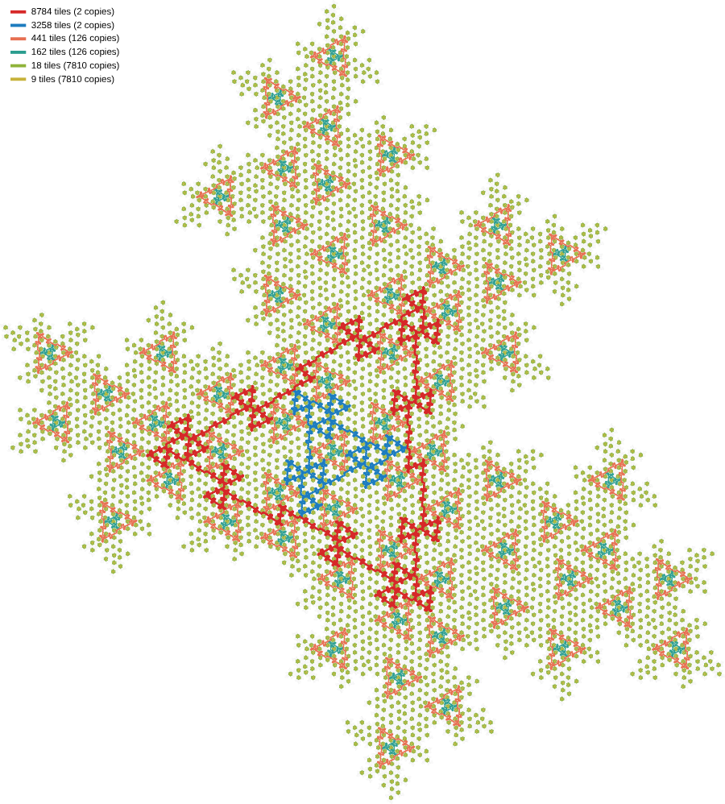

# Harmonics: the same circuit two levels up

The triangles of a triangle fractal come in lineages. In hexagon rule
`023468`, combination `000100000` (the Circuit walker's default), a
441-tile triangle sits inside every level-4 supertile and an 8784-tile one
inside every level-6 supertile; the corners of the small one lie on the big
one, and that is how one is found from the other on the walker page. This
note says exactly what the two have in common, in the walker's own terms
(addresses, stacks, levels), and what that gives the walker's search.

Page: `harmonics.html` reads any combination of any hexagon rule from the
renormalisation (`web/src/pages/harmonics/readings.ts`), lists its lineages
and lines a circuit's readings up with its fundamental's, level by level.
Script: [`web/circuit-classes/harmonics.ts`](../web/circuit-classes/harmonics.ts)
lists every circuit of a combination with its readings and lineages;
[`web/circuit-classes/chase-harmonic.ts`](../web/circuit-classes/chase-harmonic.ts)
runs the walker's search for a harmonic with and without the rule of §4.
Tests: [`web/circuit-classes/__tests__/harmonics.test.ts`](../web/circuit-classes/__tests__/harmonics.test.ts).



*Every circuit of 9, 18, 162, 441, 3258 and 8784 tiles in a level-6 Delta.
Each 441 holds a 162; the 441s sit along the sides of the 8784, with their
corners on it; the 3258 sits inside the 8784 the way a 162 sits inside a 441.*

## 1. Reading a circuit at a level

A circuit is a cyclic word of tiles. Read at level k, it is the sequence of
level-k supertiles its strand runs through, one visit per maximal run of
tiles with the same level-k ancestor, each visit written as the supertile's
type, its slot in its parent and the parent's type: `Ph<6D` is a Phi in slot
6 of a Delta. Read at level 0 it is the tile word with each tile's slot and
parent. The level at which a crossing settles (`neighbour()` in
`core/transducer.ts`) says whether it stays inside the level-k supertile.

Where the strand runs along a seam between two supertiles it crosses the
seam back and forth, so the raw reading repeats A B A B A. A visit followed
straight away by a return to the supertile just left is cancelled, so the
reading records the supertiles the strand runs through and not how often it
crosses the seams between them.

A circuit's height is the level of the smallest supertile holding it. That
supertile can be of any of the nine types, and so can its children, so types
are compared only from two levels below the height; slots always.

## 2. Lineages

Circuit B is a harmonic of circuit A when B's height is A's plus two and B
read at level k + 2 is A read at level k for every k: B is A with every tile
grown into a level-2 supertile. Every circuit of two combinations in a
level-6 Delta:

**`023468-000000000`**

| tiles | height | copies | visits per level, 0 up |
|---|---|---|---|
| 9 | 2 | 7810 | 9 2 |
| 15 | 4 | 2656 | 15 3 3 2 |
| 27 | 2 | 7810 | 27 3 |
| 75 | 4 | 2426 | 75 12 3 2 |
| 189 | 4 | 126 | 189 18 9 2 |
| 321 | 6 | 20 | 321 33 15 3 3 2 |
| 513 | 4 | 126 | 513 57 27 3 |
| 1479 | 6 | 10 | 1479 162 75 12 3 2 |
| 3789 | 6 | 2 | 3789 408 189 18 9 2 |
| 10215 | 6 | 2 | 10215 1107 513 57 27 3 |

| lineage | growth | readings |
|---|---|---|
| 27 → 513 → 10215 | ×19.0, ×19.9 | the same at every level |
| 9 → 189 → 3789 | ×21.0, ×20.1 | the same at every level |
| 75 → 1479 | ×19.7 | the same at every level |
| 15 → 321 | ×21.4 | the same at every level |

The table of visits shows it directly: 513 reads `513 57 27 3` and 27 reads
`27 3`; 10215 reads `10215 1107 513 57 27 3`. Each harmonic's row ends with
its fundamental's row.

**`023468-000100000`** (the walker's default)

| tiles | height | copies | visits per level, 0 up |
|---|---|---|---|
| 3 | 2 | 45866 | 3 2 |
| 9 | 2 | 7810 | 9 2 |
| 15 | 4 | 2656 | 15 3 3 2 |
| 18 | 2 | 7810 | 18 3 |
| 66 | 4 | 2426 | 66 12 3 2 |
| 162 | 4 | 126 | 162 18 9 2 |
| 276 | 6 | 20 | 276 33 15 3 3 2 |
| 441 | 4 | 126 | 441 57 27 3 |
| 1272 | 6 | 10 | 1272 162 75 12 3 2 |
| 3258 | 6 | 2 | 3258 408 189 18 9 2 |
| 8784 | 6 | 2 | 8784 1107 513 57 27 3 |

| lineage | growth | readings |
|---|---|---|
| 18 → 441 → 8784 | ×24.5, ×19.9 | the same above level 2; at level 2, loops round junctions |
| 9 → 162 → 3258 | ×18.0, ×20.1 | the same above level 2; at level 2, loops round junctions |
| 66 → 1272 | ×19.3 | the same above level 2; at level 2, loops round junctions |
| 15 → 276 | ×18.4 | the same at every level |

The 3-tile loop round a vertex has no harmonic. The two combinations differ
in one tile's pairing (Xi), and their lineages line up: 27/513/10215 against
18/441/8784, 9/189/3789 against 9/162/3258, 75/1479 against 66/1272,
15/321 against 15/276.

### Loops round junctions

Where a lineage of `000100000` reads the same only above level 2, the
difference at level 2 is always the same thing. Lining the harmonic's
level-2 reading up with the fundamental's tile word (longest common
subsequence, over every rotation and both directions), none of the
fundamental's tiles is missing, and every extra run of the harmonic is a
loop: the strand leaves a level-2 Xi for a Phi and a Gamma in slots 6 and 7
of the neighbouring level-3 supertile and comes back into the same Xi.

| lineage | extra runs at level 2 | shape of each |
|---|---|---|
| 18 → 441 | 3 | `X<5` or `X<0`, `G<7` (16 tiles), `Ph<6` (6 tiles) |
| 9 → 162 | 9 | `X<2`, `Ph<6` (6), `G<7` (16) |
| 441 → 8784 | 24 | `X<2`, `Ph<6` (6), `G<7` (16) |
| 66 → 1272 | 3 | `X<2`, `G<7` (16), `Ph<6` (6) |

A loop is where the fractal strand passes a point where three level-2
supertiles meet and clips the corners of the two it does not belong in. In
`000000000` the Xi pairing routes the strand past those corners, and the
readings agree down to the tiles.

### The corners

For the 441-tile triangles in a level-6 Delta: of 126 copies, 48 share tiles
with one of the two 8784-tile triangles, and 18 of those lie with all three
corner tiles on it. Of 126 copies of the 162-tile circuit, every one has
each corner tile on two 441-tile triangles. So clicking a corner of a
triangle on the walker page starts a walk on the harmonic, when the triangle
is one of the ones along the harmonic's sides.

## 3. In the walker's stacks

A stack is the start tile's ancestors; the walk extends it only when a
crossing needs the next level. Reading at level 2 says: B's stacks with the
bottom two levels cut off are A's stacks. The walker's forks along the two
circuits, each followed from its first tile on every stack at once:

| circuit | forks | decided at level |
|---|---|---|
| 18 | 2 | parent, parent |
| 441 | 13 | 1, 1, 1, 1, 2, 2, 3, 3, 3, 3, 3, 3, 3 |

The 441's forks decided at level 3 and above are the forks A's walk makes
two levels down, with the same cells; the forks decided at levels 1 and 2
have no counterpart in A. They are the strand choosing its way along the
seams inside level-2 supertiles, and there are more of them than the
fundamental has forks in all.

## 4. Finding a harmonic ahead of the search

Once the walker has closed on a circuit A of height h, this is known about
its harmonic before any search:

- it exists in every level-(h + 2) supertile of every type (so from any
  start tile whose level-2 supertile is one of A's tiles), and closes at
  height h + 2 with about 19.9 times A's tiles, the triangle growth of
  [`PLACEMENTS.md`](PLACEMENTS.md);
- its readings from level 3 up are A's from level 1 up, so every fork
  decided at level 3 or above is decided by a cell A uses two levels down.

`chase-harmonic.ts` applies the second as a rule in the walker's own search
(every landing at every fork, shortest branch first): A is followed on every
stack at once, its closing stacks are replayed to list the cells its tiles
have at each level, and in B's search a fork decided at level 3 or above
keeps only the landings whose cells two levels down are in that list. The
rule cannot drop a landing on B's own branch. From the 441's first tile,
searching every landing until every branch ends:

| | forks | decided at level 1, 2, 3, 4, 5 | branches | landings dropped | closes on 441 |
|---|---|---|---|---|---|
| plain search | 422 | 47, 62, 242, 57, 9 | 848 | 0 | 45 branches |
| with the rule | 236 | 38, 52, 111, 30, 2 | 377 | 99 | 36 branches |

The rule halves the level-3 forks; the forks at levels 1 and 2 are left to
the search, and they are most of the rest. One harmonic up, from the 8784's
first tile with the 441 as fundamental and the search capped at 3,000
forks, the rule drops 549 landings and both searches close on the 8784
within the cap (1,275 and 1,282 branches); the forks there are decided at
levels 3, 4 and 5 in about equal numbers, and the rule reaches only the
ones whose deciding cells the 441 never uses. From every start tile and entry
edge of the rule (34 starts), the search with the rule closes on the 441
from each of the 22 starts that lie on one, in 113 to 406 forks; the other
12 starts close on the 3-, 9- or 18-tile circuits within two forks.

### Open ends

- A rule that follows A's tile word as B's level-2 reading grows would cut
  the search to about one branch, but the strand's wiggles along seams and
  its loops round junctions interleave in ways a short automaton (cancel a
  backtrack, allow an excursion of two supertiles) does not capture: along
  the 441, 186 stacks are alive at step 18 and all are rejected by step 19.
  The reading is a property of a closed circuit; matched as a prefix it needs
  the reduction of §1 to be done on the fly, which is not confluent.
- The harmonic can be constructed instead of searched. The renormalisation
  (`circuit-classes/circuit-shapes.ts`) keeps every arc's route through its
  children, so the circuit born in a level-(h + 2) supertile through the
  same child slots as A can be expanded on its own; the walker could offer
  it as a walk to follow (`followWord`) rather than a branch to find.
- Why the loops round junctions are always Xi, Phi in slot 6, Gamma in slot
  7, and only in combinations whose Xi pairing is the second option.

## On the Top-down map

The Top-down page grows a harmonic where it stands. Pick a closed circuit
on a map of hexagons and press "Grow its harmonic": the circuit's tiles and
a margin of two tiles round them are substituted twice, the strands are
traced among the tiles two depths down, and the closed strand that reads as
the circuit is picked out, with the circuit's former tiles drawn as the
level-2 supertiles they have become. Reading a strand two levels up on the
map is literal: each chord lies in a tile whose slot path, cut by two slots,
is one of the circuit's tiles, and the sequence of those, backtracks across
a seam and loops into the margin cancelled, is compared with the circuit's
own route (`web/src/pages/topdown/harmonic.ts`). The margin is two tiles
because the loops round junctions reach two tiles out: with one, the 441 of
`000100000` comes out as three open strands of 142 tiles, cut at its corners.

The tests grow the 18-tile triangle of `000100000` into the 441 (exact,
three loops cancelled) and the 27 of the base combination into the 513
(exact, no loops), on the map, by substitution alone: a check of the
readings of §2 that shares no code with them.

### Comparing any two

Not every pair that looks like a lineage is one. In `023468-140000001` the
303-tile circuit at level 4 and the 14,679-tile one at level 6 read the
same at the 303's top two levels and differ below, and 2,079 at level 5 and
103,851 at level 7 agree at the top three. The page lists such pairs as
near-lineages (a dashed ≈ after the smaller circuit, with how many top
levels agree) and lines any two circuits up on request: the bigger one's
level k + d against the smaller one's level k, where d is the difference of
their birth levels, each level marked the same or differing, and where they
differ the tokens the other reading does not share outlined, after the
best rotation and direction (longest common subsequence, for readings up to
2,500 tokens). Tokens are drawn as chips in their type's colour.

## When the walker's search can stop, and when it cannot

The walker searches from one start tile and entry edge over every stack at
once, so it finds every circuit that any tiling puts through that tile. A
tile lies on a bigger harmonic in the tilings where it sits deep inside a
bigger supertile, and there are infinitely many of those; their measure
shrinks, since in `000100000` a tile is on a 441 with probability 441/3,840
(11%) and on an 8,784 with probability 8,784/238,000 (3.7%), and by about a
third more at each step up, but the search tree does not weigh branches by
measure, so it keeps finding them. A search that stops needs a reason to
believe that every circuit beyond some level is a harmonic of one it has.

That reason can only come from the renormalisation, and it is checked per
combination, not assumed. `new-fundamentals.ts` runs every combination of a
rule up the renormalisation and counts, per level, the circuits born and how
many are new (not a harmonic of a birth two levels below). For the 320
combinations of rule `023468` to level 7
([data](harmonics/new-fundamentals-023468-7.txt)):

| last level with a new fundamental | combinations |
|---|---|
| 4 | 106 |
| 5 | 24 |
| 6 | 98 |
| 7 | 92 |

| combinations with | count |
|---|---|
| at least one harmonic pair by level 7 | 233 |
| none | 87 |

For the 106 combinations in the first row, including both of §2, every
circuit born at levels 5, 6 and 7 is a harmonic of an earlier one, and the
two of §2 keep that to level 8 (`000100000`: 4 born at level 8, 0 new;
`000000000` the same). For those a search can stop at the last new level
plus two, having seen one harmonic of each lineage, and lose nothing that
levels 5 to 8 would show. For the 92 in the last row level 7 itself brings
new fundamentals, and for the 98 in the third row level 6 was new and level
8 has not been looked at. For those a stop rule has no basis yet.

Two combinations show what "new" can mean. `111000100`, the space-filling
family of [`DEEP_ORBIT.md`](DEEP_ORBIT.md), is born at levels 6 and 8; the
level-8 circuits read the same as the level-6 ones at their top three
levels and get denser below (669 visits at level 2 against 372 tiles), which
is what a circuit of dimension 2 must do. `011000101`, a triangle fractal
with births at every level, has its 11,790-tile triangle agree with its
630-tile one only at the top level; below that the readings differ in
length, not just in loops. So the exact relation of §2 belongs to some
triangle combinations and not to others, and the walker cannot assume it.

What follows for the walker:

- Classify each closed circuit by its readings against those already found,
  so the found list shows lineages rather than an ever longer list.
- Take the level cap from the renormalisation of the combination in hand:
  the last level with a new fundamental plus two, when the levels above it
  have been run and bring none. The Harmonics page's summary line is that
  check ("Level 6: 4 born, 0 new"), and Next level extends it.
- Where the renormalisation still brings new fundamentals at its last level,
  do not cap; say so.

None of this is a proof that a combination's births stay harmonic for ever.
It is the same standing as [`PLACEMENTS.md`](PLACEMENTS.md): exact as far as
the renormalisation has been run, and the page lets that be as far as the
machine allows.

## The page

The readings on the Harmonics page come from the renormalisation
(`shapes/circuitShapes.ts`), which keeps every arc's route through its
children: a visit at level k is one arc through a level-k supertile, and a
born circuit is read at every level without building a patch, so a
combination is read to level 9 in a few seconds. The tests check the
renormalisation's readings against the tile-by-tile trace for every circuit
of the base combination at every level.

## Reproducing

```bash
cd web
npx tsx circuit-classes/harmonics.ts 023468-000000000 6
npx tsx circuit-classes/harmonics.ts 023468-000100000 6
npx tsx circuit-classes/chase-harmonic.ts 023468-000100000 5 6 18 441
npx vitest run circuit-classes/__tests__/harmonics.test.ts
```

Level 6 traces 242,047 tiles in about 35 s; the chase from one start takes
about 30 s.
