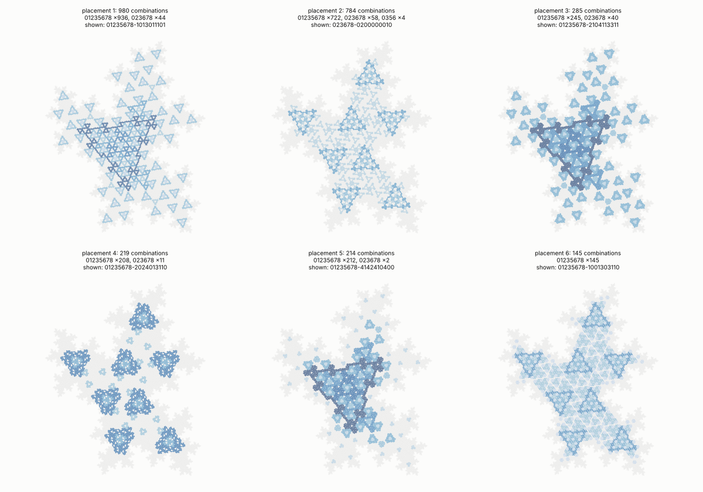
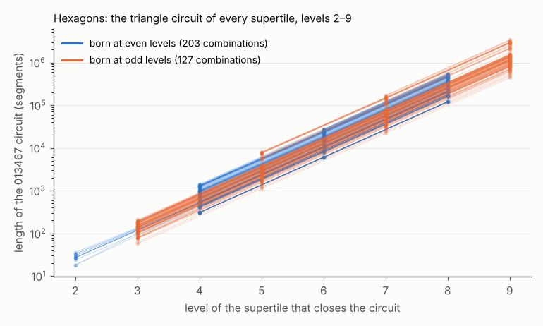

# Placements: which combinations put their circuits in the same places

Lots of combinations draw nested triangles, and the triangles look like they
sit on the same fault lines. This note sorts combinations by **where** their
big circuits are, not by what kind of pattern they make, and then explains the
groups using the substitution and the GF(2) structure of the rules.

Short version:

1. **Only rules that contain class 0 make triangles.** The tail-free rules form
   a group (Z/2)³. The ones without class 0 form a subgroup
   W = {∅, 15, 1278, 2578} (hexagons: {∅, 15, 128, 258}), and those rules give
   bounded loops, thin circuits or lines. Every triangle fractal is in the other
   coset, and class 0 always comes with 3 and 6.
2. **Rules that differ by `15` put their circuits in the same places.**
   `0136` and `0356` match at correlation 0.99, `023678` and the full rule
   `01235678` at 0.87, and `1278` with `2578` as well as either does with
   itself. `15` only makes loops of 3, 6 and 9 segments, so adding it to a rule
   only changes the strands locally.
3. **A placement is a set of levels.** Each big triangle belongs to one
   supertile, and the circuit closes inside it, passing through its children
   **0, 1, 3, 4, 6, 7** (never 2 or 5). It happens in *every* supertile of
   *every* type at the levels where it happens at all. Those levels are every
   other one: odd levels or even levels. That parity, plus the level the
   sequence starts at and whether a smaller circuit through children **1, 4, 7**
   also closes, is the placement. About 3,000 combinations of three rules
   collapse into a handful of placements.
4. **It's exact on the hexagons up to level 9**, from the FASS routing operator
   extended to carry circuit lengths. Triangle circuits grow ×19.9 every two
   levels (dimension ≈ 1.45). Supertile boundaries grow ×(2+√5) = ×4.236 per
   level (dimension ≈ 1.40). So the triangles are a little rougher than the
   supertile outlines, not copies of them.

## 1. Comparing placements

Every combination of a family is drawn on the same level-6 Delta supertile, so
two combinations can be compared tile by tile.
[`placement-maps.ts`](../web/circuit-classes/placement-maps.ts) records, per
tile, the longest circuit through it. Two combinations are compared on a coarse
map: for every level-1 supertile, the fraction of its tiles that lie on a
circuit of at least 2⁸ = 256 segments. The comparison is the Pearson
correlation of those maps.

Mean over each row rule's growing combinations of the best match in the column
rule (diagonal: best match other than itself):

**Tile(1,1)**

| | `0136` | `0356` | `1278` | `2578` | `023678` |
|---|---|---|---|---|---|
| `0136` | 0.99 | **0.99** | 0.20 | 0.18 | 0.59 |
| `0356` | 0.55 | 1.00 | 0.29 | 0.28 | 0.85 |
| `1278` | 0.07 | 0.16 | 0.37 | **0.41** | 0.16 |
| `2578` | 0.06 | 0.16 | **0.39** | 0.37 | 0.19 |
| `023678` | 0.23 | 0.46 | 0.19 | 0.26 | 0.99 |

**Hexagons**

| | `128` | `258` | `01346` | `03456` | `023468` |
|---|---|---|---|---|---|
| `128` | 0.37 | **0.41** | 0.16 | 0.16 | 0.17 |
| `258` | **0.39** | 0.37 | 0.17 | 0.19 | 0.19 |
| `01346` | 0.21 | 0.23 | 0.73 | **0.85** | 0.85 |
| `03456` | 0.25 | 0.27 | 0.81 | 0.94 | 0.94 |
| `023468` | 0.15 | 0.24 | 0.88 | 0.91 | 0.99 |

There are two worlds. The class-0 rules share their spots with each other. The
`1278`/`2578` thin circuits are chaotic: even two combinations of the same rule
only correlate at about 0.4, but across the `15` pair they match each other as
well as they match themselves. A sample of 3,000 of the full rule's 625,000
combinations (evenly spaced in index order) matches `023678` at a mean best
correlation of 0.87 (triangle class) and 0.98 (mixed class), and `0136` at only 0.20.

### The placements

Average-linkage clusters at correlation 0.7 over the growing combinations of
all seven rules, with the full-rule sample. The six biggest, each drawn with its most central member
(tiles on circuits of 256+ segments, darker = longer):



[`circuit-sites.ts`](../web/circuit-classes/circuit-sites.ts) finds, for every
circuit of 20+ segments, the smallest supertile containing it, and which of its
children the circuit passes through. For the six combinations shown, at level 6:

| placement | example | `013467` circuits closed at levels | `147` circuits closed at levels |
|---|---|---|---|
| 1 (980) | `01235678-1013011101` | 4, 6 | 4, 5, 6 |
| 2 (784) | `023678-0200000010` | 3, 5 | 3, 5, 6 |
| 3 (285) | `01235678-2104113311` | 4, 6 | 4, 6 |
| 4 (219) | `01235678-2024013110` | 5 | 5 |
| 5 (214) | `01235678-4142410400` | 6 | 4, 6 |
| 6 (145) | `01235678-1001303110` | 5 | 3, 4, 5, 6 |

Within one combination, every level-k supertile in the patch gets its own
circuit, whatever its type: 63 at level 4 and 8 at level 5 inside the level-6
Delta. The set of children it passes through, 0, 1, 3, 4, 6, 7, is the same
for all nine types. So "the same fault lines" means the same slots of the substitution at
the same levels, and the triangle you see at scale k is the circuit closed by
the level-k supertiles.

### What it is not

The first guess was that triangles run along the outlines of deep supertiles.
[`placement-maps.ts`](../web/circuit-classes/placement-maps.ts) also histograms
each circuit's crossings by the depth of the seam crossed (the level of the
smallest supertile containing both tiles). The big circuits are enriched on deep
seams by at most 2–4×, and not consistently. A strand that runs *along* a fault
crosses seams *across* it, mostly shallow ones, so this measure is weak by
construction. The ownership tally above is the one that separates placements
cleanly.

## 2. Exact, at every level up to 9

[`docs/FASS_THEOREM.md`](FASS_THEOREM.md) §3 reduces a supertile's strands to a
*routing state* (the matching its arcs make on its boundary dots) and shows the
substitution acts on states by one fixed operator F. F depends on the rule and
the combination only through the level-1 states, so
[`routing-orbit.ts`](../web/circuit-classes/routing-orbit.ts) runs it for any
combination. It also carries arc lengths and records every circuit a supertile
closes that none of its children contained: its length and the child slots it
uses. It costs about the size of the supertile's boundary, not its area, so
level 9 (about 10⁸ tiles) takes seconds.

All 444 hexagon combinations, levels 2–9:

| rule | `013467` circuit closed at even levels | at odd levels | never |
|---|---|---|---|
| `15`, `128`, `258` | 0 | 0 | 100 |
| `01346` | 2 | 5 | 1 |
| `03456` | 4 | 12 | 0 |
| `023468` | 197 | 110 | 13 |

No combination closes one at both parities. Once it starts, it closes at every
second level in all nine types, and its length grows by the same factor:



* The ratio from level 7 to 9 is 19.86–19.95 for every combination. With the
  substitution's area inflation λ = 4 + √15 ≈ 7.873, that's a dimension of
  ln 19.9 / ln λ ≈ **1.45**. The Classifications page's rough estimate for the
  triangle class is "≈ 1.4".
* A supertile's boundary dots grow by 4.2361 = **2 + √5** per level, a dimension
  of 2 ln(2+√5) / ln λ ≈ **1.40**. The triangles are rougher than the supertile
  outlines.
* `128-000000000` (and the `128` combinations with the same map) close a circuit through
  children 4, 6 at *every* level, growing ×5.68 a level (dimension ≈ 1.69). That
  fits the "thin" class's ≈ 1.7.

**Which parity?** It's a function of a few tile digits, but not a GF(2)-linear
one. In `03456` the circuits close at even levels exactly when Delta's and
Sigma's digits are both 0. In `01346` it depends on Delta, Sigma and Gamma
together. The substitution mirrors every level (`levelMirror`), and the FASS
dot layout has period 2, which is where a period-2 phenomenon can come from.
But the parity is chosen by the pairing, not forced by the mirror.

## 3. The group picture, put together

* The tail-free rules are the null space of the types × classes incidence
  matrix over GF(2), V ≅ (Z/2)³, spanned by `15`, `0136`, `1278` (Tile(1,1)).
* The character χ(R) = [0 ∈ R] splits V into W = ker χ = ⟨15, 1278⟩ (no
  triangles) and its coset (triangles).
* Quotienting by ⟨15⟩ leaves V/⟨15⟩ ≅ (Z/2)², and placements are (nearly)
  constant on those cosets: {`0136`, `0356`}, {`1278`, `2578`},
  {`023678`, `01235678`}. A plausible mechanism, not yet proved: the set of
  crossed seams is a GF(2) 1-cycle on the dual graph, the rules R and R + 15
  differ by the `15` cycle, and that cycle is a sum of loops of at most 9
  segments. So the long strands can only be rerouted locally.
* Inside a coset, the combination picks a placement. Placements are labelled by
  the substitution, not by the group: a parity (Z/2), a start level, and
  whether the `147` circuit closes too.

## Open ends

* **Tile(1,1) in the exact operator.** `routing-orbit.ts` only runs on the
  hexagons for now. On Tile(1,1), a two-edge class-0 seam has its dot on the
  shared vertex, but the boundary-word model puts dots on edge midpoints.
* **Periodicity.** The FASS rules have a finite state space. In general the
  number of boundary dots grows ×(2+√5) per level, so "every other level,
  forever" is checked to level 9, not proved. The births have such a rigid
  shape (same slots, all nine types, a fixed growth factor) that the sel15-style
  vertex machine or the FASS induction might prove it.
* **The 15-coset claim** is a measured correlation on one patch. Pairing each
  combination of R with its best match in R + 15 and checking that the long
  circuits agree up to bounded detours would make it exact.
* **What decides the parity**, as a rule on the digits.

## Reproducing

```bash
cd web
npx tsx circuit-classes/placement-maps.ts spectre 6 circuit-classes/data/maps
npx tsx circuit-classes/placement-maps.ts hex 6 circuit-classes/data/maps
npx tsx circuit-classes/placement-maps.ts spectre 6 circuit-classes/data/maps 15,0136,0356,1278,2578,023678,01235678 3000
npx tsx circuit-classes/circuit-sites.ts spectre 6 20 023678-0200000010 01235678-1013011101
npx tsx circuit-classes/routing-orbit.ts hex 9 03456-000000000 03456-100000000 > circuit-classes/data/orbit/hex-03456.jsonl
python3 circuit-classes/placements.py      # tables, the parity counts and both figures
```

`placements.py` reads every `data/orbit/hex-*.jsonl`. The table above used every
combination of the six small hexagon rules. The level-6 sweeps take seconds per
rule, the 3,000-combination full-rule sample a few minutes, and the operator
about 5 s per combination at level 9.
